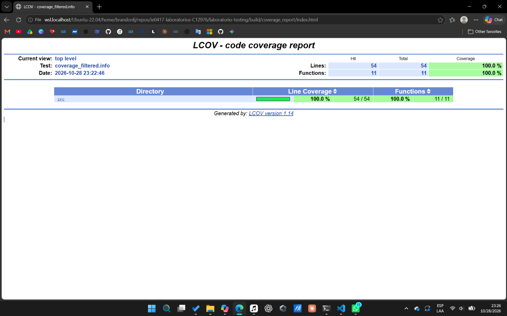

# Cobertura de código

## Parte 8: cobertura de código

### Qué se hizo

Se limpió la compilación anterior, se volvió a configurar el proyecto con la cobertura activada, se ejecutaron las 41 pruebas y se generó un reporte HTML con `lcov` y `genhtml`.

### Qué es cobertura de código

Es una métrica que indica qué partes del código se ejecutaron mientras corrían las pruebas [1]. Sirve para encontrar partes que ninguna prueba toca y así decidir qué pruebas faltan. Se puede medir por líneas, por funciones o por ramas.

### Comandos ejecutados

```bash
rm -rf build
mkdir build
cd build
cmake -DENABLE_COVERAGE=ON ..
make
./run_tests
lcov --capture --directory . --output-file coverage.info --rc lcov_branch_coverage=1
lcov --remove coverage.info '/usr/*' '*/_deps/*' '*/tests/*' --output-file coverage_filtered.info --rc lcov_branch_coverage=1
genhtml coverage_filtered.info --output-directory coverage_report --branch-coverage
```

Las opciones `--rc lcov_branch_coverage=1` y `--branch-coverage` no están en el enunciado. Se agregaron para que el reporte también muestre las ramas. Las líneas y funciones no cambian con ellas.


### Resultado

```
Overall coverage rate:
  lines......: 100.0% (54 of 54 lines)
  functions..: 100.0% (11 of 11 functions)
  branches...: 87.5% (42 of 48 branches)
```

El detalle por archivo se obtuvo con `lcov --list coverage_filtered.info`.

```
Filename                |Lines       |Functions  |Branches
calculator.cpp          | 100%     12| 100%     5|75.0%      4
grade_utils.cpp         | 100%     21| 100%     3|90.0%     20
string_utils.cpp        | 100%     21| 100%     3|87.5%     24
Total:                  | 100%     54| 100%    11|87.5%     48
```

El reporte HTML completo quedó en `build/coverage_report/index.html`. La siguiente captura muestra su página principal, con 100% de líneas y de funciones.



### Archivos con mayor y menor cobertura

Los tres archivos tienen 100% de líneas y de funciones, así que la diferencia está solo en las ramas. `grade_utils.cpp` tiene la mayor cobertura de ramas con 90%, y `calculator.cpp` la menor con 75%.

### Líneas o ramas que no fueron cubiertas

No quedó ninguna línea sin ejecutar. Las 6 ramas sin cubrir se muestran en la siguiente tabla.

| Archivo | Línea | Código |
|---|---|---|
| `calculator.cpp` | 18 | `throw std::invalid_argument(...)` |
| `grade_utils.cpp` | 6 | `throw std::invalid_argument(...)` |
| `grade_utils.cpp` | 24 | `throw std::invalid_argument(...)` |
| `string_utils.cpp` | 20 | `normalized += ...` |
| `string_utils.cpp` | 24 | `std::string reversed = normalized;` |
| `string_utils.cpp` | 25 | `std::reverse(...)` |

Con `gcov -b` sobre `calculator.cpp` se vio que la rama de la línea 18 es la marcada como `(throw)`, con 0% de uso. Es una rama que el compilador genera para el caso en que la construcción de la excepción falle. Las otras dos líneas con `throw` parecen ser del mismo tipo. Las tres de `string_utils.cpp` son operaciones sobre `std::string` que podrían fallar al pedir memoria, y por eso probablemente tienen el mismo origen, aunque esto último no se verificó con `gcov`. Ninguna se puede cubrir con una prueba normal.

### Pruebas adicionales que podrían aumentar la cobertura

Como las líneas ya están al 100%, estas pruebas no subirían ese número, pero sí harían más confiable lo que ya se cubre.

1. `letter_grade(101)` debe lanzar `std::invalid_argument`. Hoy solo se prueba `-1` y un valor mayor a 100, y esta prueba ejercita el límite superior exacto de la condición `grade > 100`.
2. `count_vowels("AEIOU")` debe devolver `5`. Verifica que las vocales en mayúscula también se cuenten, y recorre todas las comparaciones del `||` de la línea 36 con la letra ya convertida.
3. `average({70, 71})` debe devolver `70.5`. Comprueba que la división no se haga entre enteros y se pierda la parte decimal.

### Qué se aprendió

Que 100% de líneas no quiere decir que todo esté cubierto, porque las ramas todavía mostraron 87.5%. También que no todo lo que queda sin cubrir es una prueba que falta, ya que varias ramas son rutas de excepción que genera el compilador.

## Preguntas de reflexión

### 1. ¿Qué significa tener 100% de cobertura?

Significa que las pruebas ejecutaron todo lo que la métrica mide, ya sean líneas, funciones o ramas [1]. En este laboratorio hay 100% de líneas y de funciones, pero 87.5% de ramas, así que "100%" siempre debe decir de qué tipo es.

### 2. ¿Tener 100% de cobertura garantiza que el programa no tiene errores?

No. La cobertura solo dice que una línea se ejecutó, no que su resultado se haya comprobado ni que el valor usado fuera el correcto. Una línea puede ejecutarse en una prueba sin ningún `EXPECT` y contarse como cubierta, aunque tenga un error.

### 3. ¿Qué diferencia hay entre cobertura de líneas y cobertura de ramas?

La cobertura de líneas cuenta cuántas líneas se ejecutaron [1]. La de ramas cuenta cuántas de las salidas posibles de cada decisión se tomaron, por ejemplo el caso verdadero y el falso de un `if`. Por eso el reporte muestra 100% de líneas y 87.5% de ramas. Una línea como el `throw` de `divide` se ejecuta, pero la salida de excepción que genera el compilador nunca se tomó [2].

## Referencias

[1] GNU Project, "Introduction to gcov", en Using the GNU Compiler Collection (GCC). https://gcc.gnu.org/onlinedocs/gcc/Gcov-Intro.html

[2] Linux Test Project, "LCOV", en GitHub. https://github.com/linux-test-project/lcov
