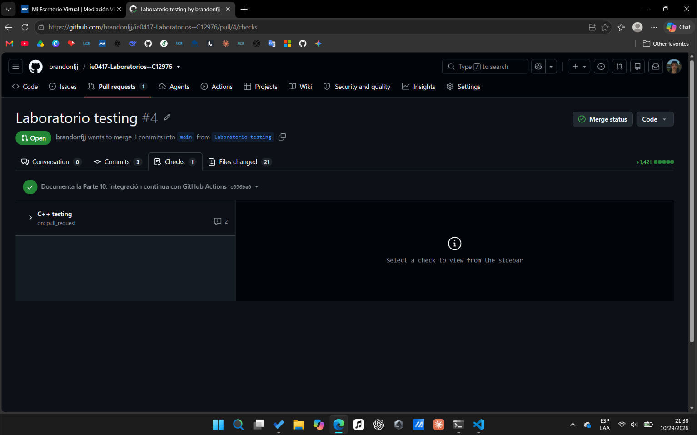
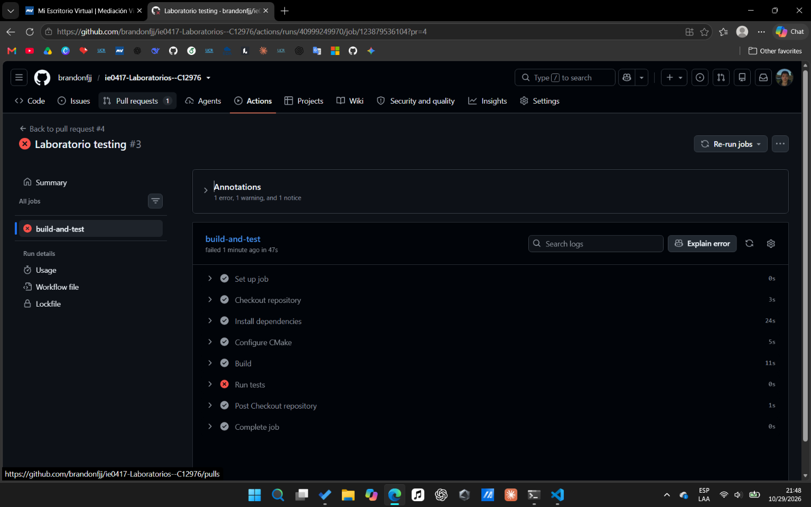
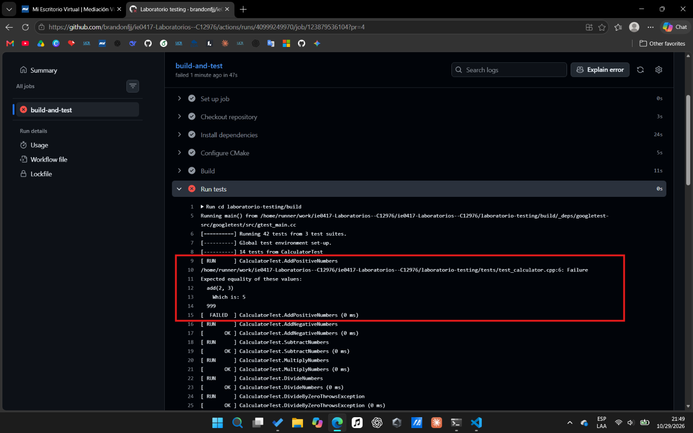
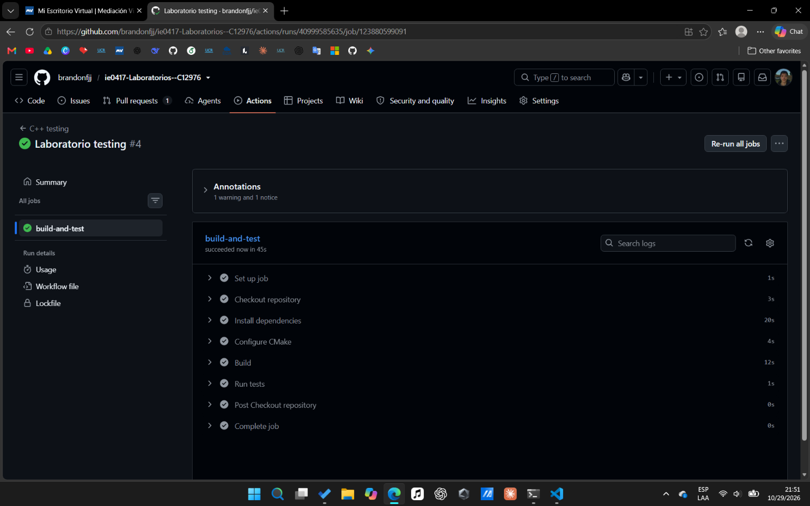

# GitHub Actions

## Parte 10: integración continua con GitHub Actions

### Qué se hizo

Se creó un workflow de GitHub Actions que compila el proyecto y ejecuta las pruebas cada vez que hay cambios hacia `main`. Luego se subió la rama `Laboratorio-testing`, se abrió un pull request hacia `main` y se revisó la ejecución en la pestaña Actions.

### Archivo creado

`.github/workflows/testing.yml`, con el contenido del enunciado.

El enunciado ubica la carpeta `.github/workflows/` dentro de `laboratorio-testing/`, pero GitHub solo lee esa carpeta en la raíz del repositorio [1]. Como `laboratorio-testing/` es una subcarpeta del repositorio, el archivo se creó en la raíz. Por eso se conservaron los `cd laboratorio-testing` del workflow, que en este caso sí hacen falta.

### Comandos ejecutados

Se ejecutaron desde la raíz del repositorio.

```bash
git status
git add .github
git commit -m "Agrega workflow de GitHub Actions para compilar y ejecutar las pruebas"
git push
```

Se usó `git add .github` en lugar de `git add .` para no agregar las carpetas de otros laboratorios que aparecen sin seguimiento. El workflow solo escucha eventos de `main`, así que el push a `Laboratorio-testing` no lo ejecutó. Se abrió un pull request hacia `main` desde GitHub y eso sí lo disparó.

### Resultado

La ejecución terminó con estado **Success**. Los cinco pasos del workflow, más los pasos que agrega GitHub al inicio y al final, salieron con ✔.


En el paso `Run tests` se ven las 42 pruebas aprobadas.


GitHub también mostró dos avisos, que no son errores. Uno indica que `actions/checkout@v4` usa una versión de Node que se está retirando, y el otro que la etiqueta `ubuntu-latest` pasará a Ubuntu 26.

### Qué es integración continua

Es una práctica en la que se sube código con frecuencia a un repositorio compartido y cada cambio se compila y se prueba de forma automática [2]. Así los errores se detectan pronto y es más fácil encontrar qué cambio los causó.

### Qué hace el archivo `testing.yml`

Define un workflow llamado `C++ testing` con un solo trabajo, `build-and-test`. Ese trabajo se ejecuta en una máquina virtual con Ubuntu que GitHub proporciona [1]. Instala las herramientas, configura el proyecto con CMake, lo compila y ejecuta las pruebas.

### En qué eventos se ejecuta

En dos eventos [1]. Cuando se hace un `push` a la rama `main` y cuando se abre o se actualiza un `pull_request` cuyo destino es `main`. Los push a otras ramas no lo ejecutan.

### Qué pasos ejecuta

| Paso | Qué hace |
|---|---|
| Checkout repository | Descarga el código del repositorio con `actions/checkout@v4` |
| Install dependencies | Instala `build-essential`, `cmake` y `lcov` con `apt` |
| Configure CMake | Crea `laboratorio-testing/build` y ejecuta `cmake ..` |
| Build | Compila con `make` |
| Run tests | Ejecuta `./run_tests` |

### Qué pasaría si una prueba falla en GitHub Actions

`./run_tests` terminaría con un código de error y el paso `Run tests` saldría con ✘. Eso haría que el trabajo completo fallara, y el pull request mostraría el resultado como fallido [2]. En el registro del paso quedaría visible cuál prueba falló y qué valores comparó, igual que en la terminal local.

### Qué se aprendió

Que el workflow solo se ejecuta si está en el lugar correcto y se dispara con el evento correcto. En este caso fue necesario ponerlo en la raíz del repositorio y abrir un pull request, porque un push a la rama de trabajo no lo activaba.

## Preguntas de reflexión de la Parte 10

### 1. ¿Por qué es útil ejecutar pruebas automáticamente en GitHub?

Porque las pruebas se ejecutan en una máquina limpia y sin depender de lo que tenga instalado cada persona. Además nadie tiene que acordarse de correrlas, ya que se ejecutan solas con cada cambio [2].

### 2. ¿Qué problema resuelve la integración continua?

Evita que los errores se acumulen sin ser detectados. Al probar cada cambio apenas se sube, se sabe pronto si algo se rompió y es más fácil encontrar el cambio responsable [2].

### 3. ¿Por qué conviene ejecutar pruebas antes de integrar cambios?

Porque una vez que el código está en `main`, los demás lo usan como base. Si las pruebas corren antes del merge, un error se ve en el pull request y no llega a la rama principal [2]. Eso fue lo que se hizo en este laboratorio, donde el workflow corrió sobre el pull request antes de integrar nada.

### 4. ¿Qué información proporciona GitHub Actions cuando un workflow falla?

Muestra qué trabajo y qué paso fallaron, y el registro completo de cada paso. En el caso de las pruebas, el registro incluye la salida de Google Test, con la prueba que falló y los valores esperado y obtenido. También marca el resultado en el pull request [2].

### 5. ¿Cómo ayuda CI a mejorar la colaboración en equipo?

Da una verificación común que no depende de la máquina de nadie. Quien revisa un pull request puede ver si las pruebas pasaron sin tener que ejecutarlas, y quien lo escribió sabe pronto si afectó el trabajo de los demás [2].

## Parte 11: fallo intencional en CI

## Fallo intencional en CI

### Qué se hizo

Se rompió una prueba a propósito para ver cómo reacciona GitHub Actions, y después se corrigió. Antes del cambio, el pull request mostraba el workflow en verde.



### Qué cambio se hizo para provocar el fallo

Se modificó `tests/test_calculator.cpp`. En la prueba `AddPositiveNumbers` se cambió el valor esperado de 5 a 999.

```cpp
EXPECT_EQ(add(2, 3), 999);
```

### Qué pasó localmente

Se compiló con `make` y se ejecutó `./run_tests` desde `build/`. Pasaron 41 de las 42 pruebas y falló `CalculatorTest.AddPositiveNumbers`. El programa terminó con código 1.

```
tests/test_calculator.cpp:6: Failure
Expected equality of these values:
  add(2, 3)
    Which is: 5
  999
[  FAILED  ] CalculatorTest.AddPositiveNumbers (0 ms)
```

### Qué pasó en GitHub Actions

Se subió el cambio con el mensaje `Introduce fallo intencional en prueba`. El pull request volvió a ejecutar el workflow y esta vez terminó en fallo. Los pasos de instalación, configuración y compilación salieron en verde, y solo `Run tests` salió con ✘, lo que hizo fallar el trabajo `build-and-test`.



### Qué mensaje mostró el workflow

En el registro de `Run tests` apareció el mismo mensaje de Google Test que en la terminal. Indica el archivo y la línea (`test_calculator.cpp:6`), el valor obtenido (5) y el esperado (999). También se vio que corrieron 42 pruebas.



### Cómo se corrigió

Se restauró el valor esperado en `tests/test_calculator.cpp`.

```cpp
EXPECT_EQ(add(2, 3), 5);
```

Se verificó en local, donde pasaron las 42 pruebas, y se subió con el mensaje `Corrige prueba fallida`.

### Evidencia del workflow exitoso después de corregir

El workflow se ejecutó otra vez sobre el pull request y todos los pasos salieron en verde.



### Comandos ejecutados

```bash
cd build
make
./run_tests
git add tests/test_calculator.cpp
git commit -m "Introduce fallo intencional en prueba"
git push
git add tests/test_calculator.cpp
git commit -m "Corrige prueba fallida"
git push
```

### Qué se aprendió

Que un error en una prueba no llega desapercibido, porque GitHub lo marca en el pull request con el mismo detalle que se ve en local. También que cada push nuevo vuelve a ejecutar el workflow, así que al corregir bastó con subir el cambio para ver el resultado en verde.

## Preguntas de reflexión de la Parte 11

### 1. ¿Por qué es útil ver una prueba fallar al menos una vez?

Porque confirma que la prueba realmente detecta errores. Una prueba que nunca ha fallado podría estar mal escrita y pasar siempre. Además permite conocer cómo se ve el mensaje de fallo y practicar cómo leerlo.

### 2. ¿Qué diferencia hay entre una prueba fallando localmente y una prueba fallando en CI?

En local el fallo solo lo ve quien ejecuta las pruebas. En CI queda registrado en el pull request y lo ve todo el equipo, porque el pull request queda marcado como fallido [2]. También se ejecuta en una máquina limpia, por lo que descarta que el fallo dependa del entorno de una persona.

### 3. ¿Por qué no se debería dejar código con pruebas fallidas en la rama principal?

Porque la rama principal es la base del trabajo de los demás. Si tiene pruebas fallidas, cualquiera que parta de ella hereda el problema y no sabe si un fallo es suyo o ya existía. Por eso conviene que las pruebas pasen antes del merge [2].

### 4. ¿Qué aporta CI a la calidad del software?

Una revisión automática y constante. Cada cambio se compila y se prueba apenas se sube, así que los errores se encuentran pronto y se corrigen cuando todavía es fácil saber qué los causó [2].

## Referencias

[1] GitHub, "Understanding GitHub Actions", en GitHub Docs. https://docs.github.com/en/actions/about-github-actions/understanding-github-actions

[2] GitHub, "About continuous integration with GitHub Actions", en GitHub Docs. https://docs.github.com/en/actions/about-github-actions/about-continuous-integration-with-github-actions
