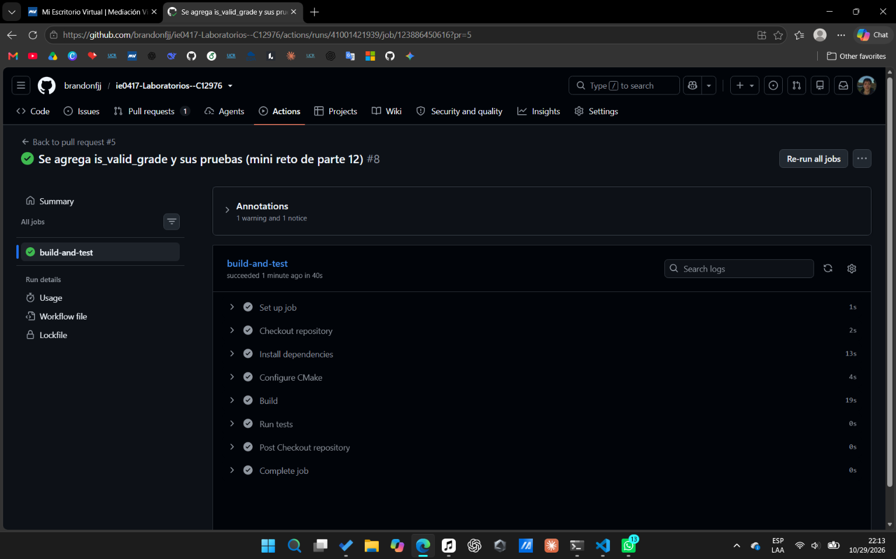

# Mini reto y reflexión final

## Parte 12: mini reto de testing

## Mini reto de testing

### Qué se hizo

Se agregó una función nueva, `is_valid_grade`, y se diseñaron seis pruebas para ella. Luego se compilaron y ejecutaron en local, y se subieron a GitHub en una rama aparte, `Laboratorio-testing-mini-reto`, con su propio pull request hacia `main`.

### Función implementada

`is_valid_grade` indica si una nota está dentro del rango permitido, de 0 a 100 incluidos.

```cpp
bool is_valid_grade(int grade) {
    return grade >= 0 && grade <= 100;
}
```

Se modificaron `include/grade_utils.h`, donde se agregó la declaración, y `src/grade_utils.cpp`, donde se agregó la implementación.

### Casos de prueba diseñados

Se agregaron en `tests/test_grade_utils.cpp`.

| Prueba | Valor | Resultado esperado |
|---|---|---|
| `ValidGradeNormalValue` | 85 | `true` |
| `InvalidGradeNormalValue` | 250 | `false` |
| `ValidGradeLowerBound` | 0 | `true` |
| `ValidGradeUpperBound` | 100 | `true` |
| `GradeJustBelowLowerBoundIsInvalid` | -1 | `false` |
| `GradeJustAboveUpperBoundIsInvalid` | 101 | `false` |

### Por qué se escogieron esos casos

Los dos casos normales comprueban el comportamiento general, uno dentro del rango y otro claramente fuera. Para el inválido se usó 250 y no un valor como 101, para que esta prueba no repita lo que ya cubre la del borde superior. Los otros cuatro rodean los dos límites, porque ahí es donde más fácil se comete un error en una comparación. Para cada límite se probó el último valor válido y el primer valor inválido.

### Comandos ejecutados

Se ejecutaron desde `laboratorio-testing/`.

```bash
cd build
make
./run_tests
```

### Resultado de las pruebas

Todas las pruebas pasaron en local, las 42 que ya existían más las 6 nuevas.

```
[ RUN      ] GradeUtilsTest.ValidGradeNormalValue
[       OK ] GradeUtilsTest.ValidGradeNormalValue (0 ms)
[ RUN      ] GradeUtilsTest.InvalidGradeNormalValue
[       OK ] GradeUtilsTest.InvalidGradeNormalValue (0 ms)
[ RUN      ] GradeUtilsTest.ValidGradeLowerBound
[       OK ] GradeUtilsTest.ValidGradeLowerBound (0 ms)
[ RUN      ] GradeUtilsTest.ValidGradeUpperBound
[       OK ] GradeUtilsTest.ValidGradeUpperBound (0 ms)
[ RUN      ] GradeUtilsTest.GradeJustBelowLowerBoundIsInvalid
[       OK ] GradeUtilsTest.GradeJustBelowLowerBoundIsInvalid (0 ms)
[ RUN      ] GradeUtilsTest.GradeJustAboveUpperBoundIsInvalid
[       OK ] GradeUtilsTest.GradeJustAboveUpperBoundIsInvalid (0 ms)
[  PASSED  ] 48 tests.
```

### Ejecución de GitHub Actions

GitHub Actions ejecutó el workflow sobre el pull request y terminó con estado exitoso. Todos los pasos salieron en verde.



### Qué se aprendió

Que diseñar buenas pruebas es decidir qué valores vale la pena probar. Con seis casos bien elegidos, sobre todo los de los bordes, se cubre el comportamiento de la función sin necesidad de probar muchos valores.

## Preguntas de reflexión de la Parte 12

### 1. ¿Cuál fue el caso más obvio de probar?

Una nota válida común, como 85. Es el uso normal de la función y es lo primero que se piensa al probarla.

### 2. ¿Cuál fue el caso borde más importante?

Los dos valores que quedan justo en el límite, 0 y 100, porque son los que separan una nota válida de una inválida. Si el límite está mal escrito, es ahí donde se nota.

### 3. ¿Qué error podría aparecer si no se prueban los valores `0` y `100`?

Que la función use `>` y `<` en lugar de `>=` y `<=`. Con 85 y 250 la función seguiría dando el resultado esperado, pero rechazaría por error un 0 o un 100, que sí son notas válidas. Ese error pasaría desapercibido.

### 4. ¿Qué diferencia hay entre probar un valor como `50` y probar valores como `-1`, `0`, `100` y `101`?

Un valor como 50 está en medio del rango y casi cualquier implementación lo trata bien, por eso no dice mucho. Los valores -1, 0, 100 y 101 están pegados a los límites, donde una condición mal escrita da un resultado distinto. Por eso detectan errores que el 50 no detecta.

### 5. ¿Qué aprendió sobre diseñar pruebas?

Que no se trata de probar muchos valores, sino de probar especificos para probar el funcionamiento. Es decir, conviene pensar primero en donde podría fallar la función y escoger los casos a partir de eso, con un caso normal y los valores alrededor de cada límite.
